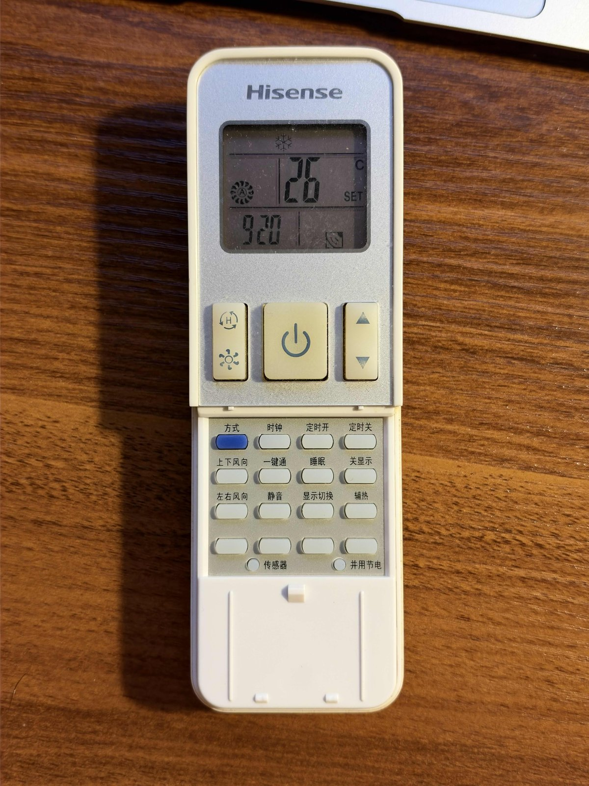
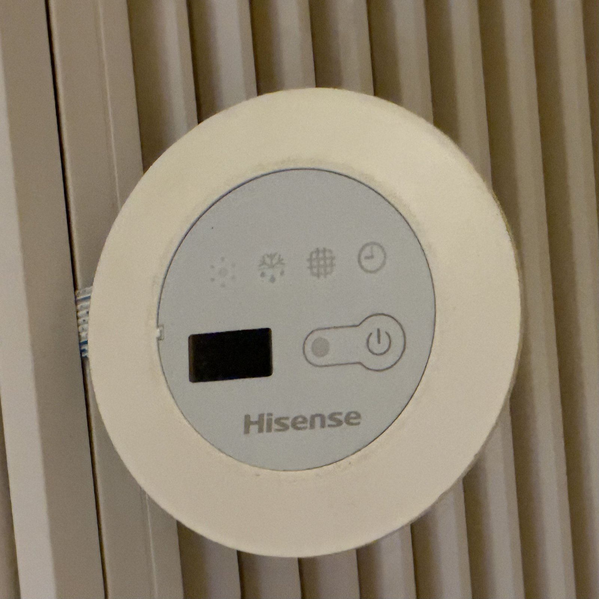

# ha-yh1-ac

English | [简体中文](README.zh-CN.md)

Home Assistant integration for air conditioners that use the **Y-H1 infrared remote**, sending through a Broadlink IR blaster (RM4 mini etc.). The protocol was reverse-engineered from real captures, and the behaviour described below was tested on a running unit.

On this AC the power button can only toggle, so a normal IR setup never knows whether the unit is on. This integration gets **deterministic on/off** anyway: the remote's SMART code always leaves the unit running, so "SMART, then the target state" guarantees on and "SMART, then power toggle" guarantees off. No extra sensor is needed.

Tested with a Hisense HURd-35KF/12F3 ducted unit (no motorised louvers).

## Hardware

| Y-H1 remote | Indoor unit control panel (IR receiver) |
|---|---|
|  |  |

Remote manual (EN/IT/ES/PT): [Y-H1 remote manual (PDF)](https://drive.google.com/file/d/1IaPjlQHiKDzoKhbjBp73_-4hZvJ5aNym/view?usp=sharing)

## Features

- `climate` entity with modes cool / heat / dry / fan only / auto (the remote's SMART mode)
- Fan speed auto / low / medium / high, target temperature 18-32°C
- Presets: boost (SUPER) and sleep
- On/off works no matter what state the unit was left in, including after someone used the physical remote
- Optional room temperature sensor, and optional power sensor to follow changes made with the physical remote
- State is restored after a Home Assistant restart

## Installation

**HACS**: HACS → ⋮ → Custom repositories → add `https://github.com/ramondsq/ha-yh1-ac` as an *Integration*, install **Y-H1 IR Air Conditioner**, then restart Home Assistant.

**Manual**: copy `custom_components/yh1_ac/` to `/config/custom_components/yh1_ac/` and restart.

Requires Home Assistant 2024.7 or newer. Your IR blaster must already be set up in the Broadlink integration.

## Configuration

Configuration is YAML only (see [ha_config_example.yaml](ha_config_example.yaml)):

```yaml
climate:
  - platform: yh1_ac
    name: Living Room AC
    unique_id: yh1_ac_living_room
    remote_entity_id: remote.rm4_mini
```

| Option | Required | Default | Description |
|---|---|---|---|
| `remote_entity_id` | yes | | Broadlink `remote` entity used to send the codes |
| `name` | no | `Air Conditioner` | Entity name |
| `unique_id` | no | | Lets you rename the entity from the UI |
| `temperature_sensor` | no | | Sensor shown as the current temperature |
| `power_sensor` | no | | Entity whose state is `on` while the AC runs, e.g. a template binary sensor on a power-metering plug |
| `delay` | no | `5` | Seconds to wait after the SMART code. The unit ignores codes sent within ~2 s of it |
| `hvac_modes` | no | all | Subset of `cool`, `heat`, `dry`, `fan_only`, `auto` |

For a second unit, add another entry with its own IR blaster. Both units receive identical codes, so each blaster must only reach its own unit.

## Notes

- Keep **I FEEL off** on the physical remote. When it is on, the remote keeps sending its own state and overrides Home Assistant.
- The Broadlink `remote` entity must be switched on, otherwise `send_command` is ignored.
- Turning on or off takes about 5 s, and the unit beeps twice.
- Temperature, fan and mode changes send a single code. If the unit was switched off with the physical remote, those codes are ignored. Pick the current mode again (or turn it off and on) to resync, or configure `power_sensor`.
- In auto (SMART) mode the target temperature is stored but not sent, because SMART-mode temperature offsets have not been verified.

## Protocol

The Y-H1 uses a variant of the **Kelon168** protocol from [IRremoteESP8266](https://github.com/crankyoldgit/IRremoteESP8266/blob/master/src/ir_Kelon.h). A frame is 21 bytes sent as 6 + 8 + 7 byte sections, LSB first. Timing is NEC-like: 9 ms / 4.6 ms header on the first section only, 560 µs mark, 1680 / 600 µs space for 1 / 0, and 8 ms between sections.

| Byte | Content |
|---|---|
| 0-1 | Fixed `83 06` |
| 2 | bits 0-1 fan (0 auto, 1 high, 2 medium, 3 low); bit 2 **power toggle**; bit 3 sleep; bit 7 vertical swing toggle |
| 3 | bits 0-2 mode (0 heat, 1 smart, 2 cool, 3 dry, 4 fan); bits 4-7 temperature − 18 |
| 4 | bit 7 smart |
| 5 | `0x90` = super |
| 6-7 | Remote clock (hour / minute); byte 6 bit 5 dimmer; byte 6 bit 7 always 1 |
| 8 | bit 6 vertical swing toggle; bit 7 horizontal swing toggle |
| 11-12 | I FEEL: byte 11 bit 7 enabled; byte 12 room temperature (°C) measured by the remote |
| 13 | Checksum = XOR of bytes 2-12 |
| 15 | Key code: 01 power, 02 temp, 03 sleep, 04 super, 06 mode, 07 v-swing, 08 h-swing, 0B mute, 11 fan, 17 smart, 00 dimmer |
| 20 | Checksum = XOR of bytes 14-19 |

Differences from IRremoteESP8266's `IRKelon168Ac`:
- The temperature offset is 18, not 16.
- Checksum 1 also covers byte 12.
- The remote never sets the library's "On" bit in byte 18 (always 0).

### Observed behaviour

- Mode, temperature, fan, sleep and super are **stateful**: every frame carries all of them.
- Power and dimmer (panel LED) are **toggles**; the unit remembers their state. While the LED is off it blinks on every received code.
- While off, the unit beeps at ordinary codes but stays off.
- **The SMART code always leaves the unit on**: it turns an off unit on and keeps a running unit on.
- Codes within ~2 s after SMART are ignored; 5 s is safe.
- Mute had no effect on this unit (beeper and fan noise unchanged in both toggle states).
- Swing bits have no effect on ducted units without louvers.
- On a ducted unit, fan speed changes take a few seconds to become audible.

## Tools

Command-line tools for further research. They use `RM4_HOST=<ip>`, or auto-discover the only Broadlink device on the LAN.

```bash
# Build and send a code
uv run --with broadlink tools/yh1_send.py mode=cool temp=26 fan=auto cmd=temp
# Learn and decode presses of the physical remote (60 s, up to 5 presses), appended to ./captures.jsonl
uv run --with broadlink tools/yh1_learn.py 60 5
```

The codec (`custom_components/yh1_ac/yh1_codec.py`) has no Home Assistant dependency.

## Tests

```bash
uv run --python 3.13 --with pytest-homeassistant-custom-component pytest
```

`tests/test_codec.py` checks the codec against every real capture in `tests/captures.jsonl`. Each one must pass the checksums, be rebuilt byte for byte from its parsed fields, and match what the remote's screen and the unit showed. `tests/test_climate.py` runs the integration inside Home Assistant and decodes every IR frame it sends.

## Credits

- [IRremoteESP8266](https://github.com/crankyoldgit/IRremoteESP8266) for the Kelon168 protocol definition
- [python-broadlink](https://github.com/mjg59/python-broadlink)

## License

[MIT](LICENSE)
