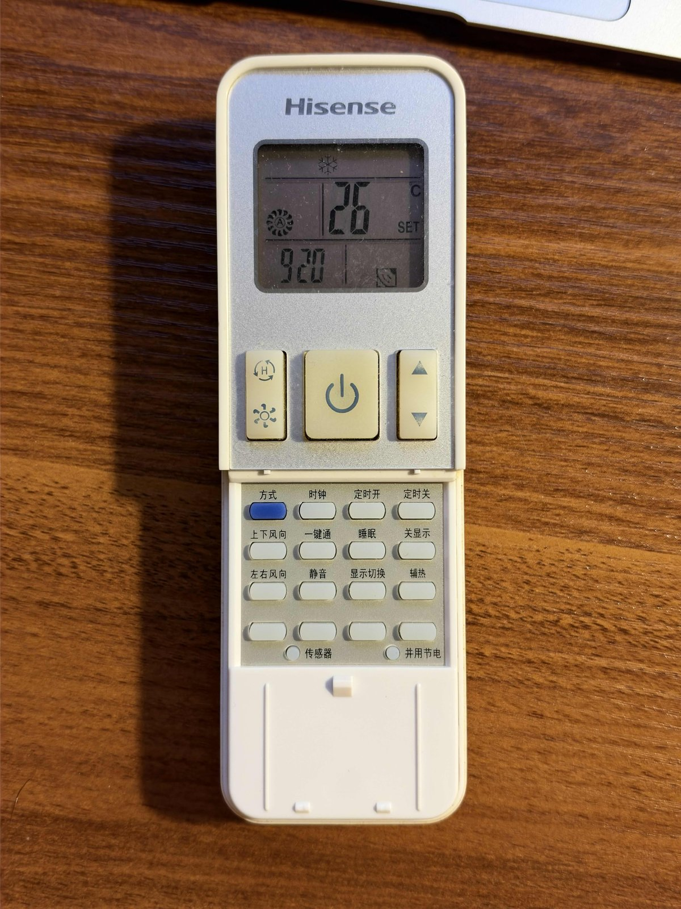
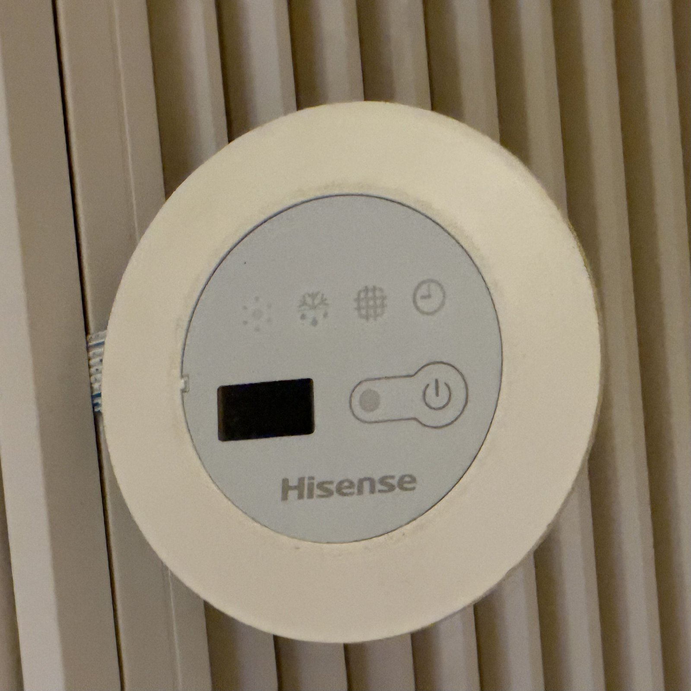

# ha-yh1-ac

[English](README.md) | 简体中文

给使用 **Y-H1 红外遥控器**的空调做的 Home Assistant 集成，通过 Broadlink 红外发射器（RM4 mini 等）发码。协议是从实抓的码逆向出来的，下文"实测行为"里的每一条都在真机上测过。

这台空调的电源键只能翻转，普通红外方案永远不知道它现在是开还是关。这个集成照样能做到**确定性开关**：遥控器的 SMART 码不管空调当前什么状态都会让它处于开机，所以"SMART → 目标状态"一定是开，"SMART → 电源翻转"一定是关。不需要额外传感器。

测试机型：海信 HURd-35KF/12F3 风管机（无电动导风板）。

## 硬件

| 遥控器 Y-H1 | 内机控制面板（红外接收器） |
|---|---|
|  |  |

遥控器说明书（英/意/西/葡）：[Y-H1 遥控器说明书 (PDF)](https://drive.google.com/file/d/1IaPjlQHiKDzoKhbjBp73_-4hZvJ5aNym/view?usp=sharing)

## 功能

- `climate` 实体，模式：制冷 / 制热 / 除湿 / 送风 / 自动（即遥控器的 SMART 智能模式）
- 风速：自动 / 低 / 中 / 高；温度 18-32°C
- 预设：超强（SUPER）、睡眠
- 不管空调之前是什么状态（包括用过实体遥控器）都能正确开关
- 可选：室温传感器；电源传感器（跟上用实体遥控器做的开关）
- HA 重启后恢复状态

## 安装

**HACS**：HACS → ⋮ → 自定义存储库 → 添加 `https://github.com/ramondsq/ha-yh1-ac`，类别选"集成"，安装 **Y-H1 IR Air Conditioner**，然后重启 HA。

**手动**：把 `custom_components/yh1_ac/` 复制到 `/config/custom_components/yh1_ac/`，重启 HA。

需要 Home Assistant 2024.7 或更新版本。红外发射器要先接入 HA 的 Broadlink 集成。

## 配置

只支持 YAML 配置（见 [ha_config_example.yaml](ha_config_example.yaml)）：

```yaml
climate:
  - platform: yh1_ac
    name: 客厅空调
    unique_id: yh1_ac_living_room
    remote_entity_id: remote.rm4_mini
```

| 选项 | 必填 | 默认值 | 说明 |
|---|---|---|---|
| `remote_entity_id` | 是 | | 用来发码的 Broadlink `remote` 实体 |
| `name` | 否 | `Air Conditioner` | 实体名称 |
| `unique_id` | 否 | | 有了它就能在界面里改名 |
| `temperature_sensor` | 否 | | 作为当前室温显示的传感器 |
| `power_sensor` | 否 | | 空调运行时状态为 `on` 的实体，比如用计量插座做的模板二值传感器 |
| `delay` | 否 | `5` | SMART 码之后等几秒再发下一个码。空调会忽略 SMART 之后约 2 秒内的码 |
| `hvac_modes` | 否 | 全部 | `cool`、`heat`、`dry`、`fan_only`、`auto` 中的一部分 |

第二台空调就再加一段配置，配一个单独的红外发射器。两台空调收的码完全一样，所以每个发射器只能照到自己那台。

## 注意事项

- 实体遥控器的 **I FEEL 要保持关闭**。开着的话遥控器会不停发它自己的状态，把 HA 设置的覆盖掉。
- HA 里 Broadlink 的 `remote` 实体必须是"开"，否则 `send_command` 会被忽略。
- 每次开机或关机大约 5 秒，空调会响两声。
- 调温度、风速、模式只发一个码。如果空调已经被实体遥控器关掉，这些码会被忽略。这时在 HA 里再选一次当前模式（或者关了再开）就能纠正，也可以配置 `power_sensor`。
- 自动（SMART）模式下调温度只记录不发码，因为智能模式下的温度微调没有验证过。

## 协议

Y-H1 用的是 [IRremoteESP8266](https://github.com/crankyoldgit/IRremoteESP8266/blob/master/src/ir_Kelon.h) 里 **Kelon168**（海信/科龙）协议的变种。每帧 21 字节，分 6 + 8 + 7 字节三段发送，LSB first。时序类似 NEC：只有第一段带 9 ms / 4.6 ms 引导，标记 560 µs，间隔 1680 / 600 µs 分别表示 1 / 0，段与段之间隔 8 ms。

| 字节 | 内容 |
|---|---|
| 0-1 | 固定 `83 06` |
| 2 | bit0-1 风速（0 自动 1 高 2 中 3 低）；bit2 **电源翻转**；bit3 睡眠；bit7 上下摆风翻转 |
| 3 | bit0-2 模式（0 制热 1 智能 2 制冷 3 除湿 4 送风）；bit4-7 温度 − 18 |
| 4 | bit7 智能 |
| 5 | `0x90` = 超强 |
| 6-7 | 遥控器时钟（时 / 分）；byte6 bit5 DIMMER；byte6 bit7 恒为 1 |
| 8 | bit6 上下摆风翻转；bit7 左右摆风翻转 |
| 11-12 | I FEEL：byte11 bit7 开关；byte12 遥控器测到的室温（°C） |
| 13 | 校验 = byte2..12 异或 |
| 15 | 按键码：01 电源 02 温度 03 睡眠 04 超强 06 模式 07 上下摆风 08 左右摆风 0B 静音 11 风速 17 智能 00 DIMMER |
| 20 | 校验 = byte14..19 异或 |

和 IRremoteESP8266 的 `IRKelon168Ac` 的差异：
- 温度偏移是 18，不是 16。
- 校验 1 还包含 byte12。
- 遥控器从不设置库里 byte18 的 On 位（恒为 0）。

### 实测行为

- 模式、温度、风速、睡眠、超强是**带状态**的，每个码都带着全部这些状态。
- 电源和 DIMMER（面板指示灯）是**翻转式**的，空调自己记住状态。指示灯关着时，收到任何码会闪一下。
- 关机时收到普通码：响一声，不开机。
- **SMART 码总是让空调处于开机**：关着就开，开着就保持。
- SMART 之后约 2 秒内的码会被忽略，5 秒没问题。
- MUTE 在这台机器上无效（开关两种状态都试过，蜂鸣器照响，风声不变）。
- 摆风位对没有导风板的风管机无效。
- 风管机调风速后要几秒才听得出变化。

## 工具

做进一步研究用的命令行工具。用 `RM4_HOST=<ip>` 指定设备，不指定就自动发现局域网里唯一的一台 Broadlink。

```bash
# 合成并发一个码
uv run --with broadlink tools/yh1_send.py mode=cool temp=26 fan=auto cmd=temp
# 学习并解码实体遥控器的按键 (60 秒, 最多 5 个), 追加到 ./captures.jsonl
uv run --with broadlink tools/yh1_learn.py 60 5
```

编解码模块 `custom_components/yh1_ac/yh1_codec.py` 不依赖 Home Assistant。

## 测试

```bash
uv run --python 3.13 --with pytest-homeassistant-custom-component pytest
```

`tests/test_codec.py` 用 `tests/captures.jsonl` 里的每一个实抓码验证编解码：校验和要对，要能从解析出的字段逐字节重新合成，还要和抓码时遥控器屏幕、空调的反应对得上。`tests/test_climate.py` 在 Home Assistant 里运行集成，并解码它发出的每一帧。

## 致谢

- [IRremoteESP8266](https://github.com/crankyoldgit/IRremoteESP8266) 提供了 Kelon168 协议定义
- [python-broadlink](https://github.com/mjg59/python-broadlink)

## 许可证

[MIT](LICENSE)
